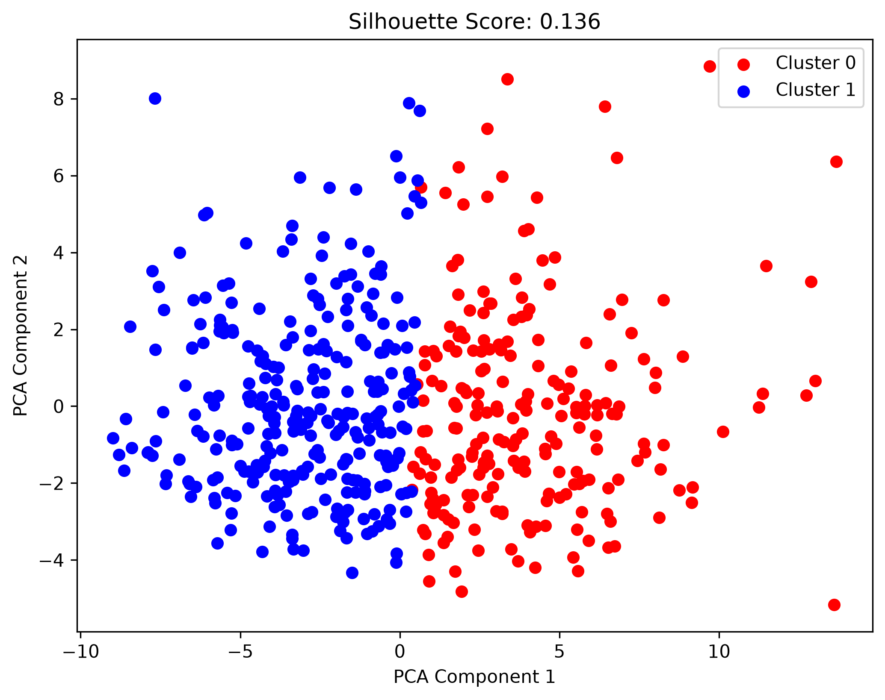

# ADHD-ML-Analyzer

A Python-based machine learning project that analyzes mental health survey data to identify patterns related to ADHD and other psychological conditions. The project focuses on **heavy data preprocessing** and an end-to-end pipeline from raw survey responses to clustering and classification.

Course project for **Artificial Intelligence**.

## Focus

This project is centered on **data preprocessing** rather than model complexity. The raw survey data contained missing values, free-text diagnosis fields, inconsistent yes/no responses, and redundant columns. The main effort went into cleaning and restructuring this data into a usable feature matrix, then applying standard ML techniques (PCA + KMeans for clustering, LazyPredict + KNN for classification) to validate the pipeline.

## Features

- **Data Cleaning & Preprocessing**: Handles missing values (most-frequent imputation), converts yes/no responses to binary, extracts diagnosis labels from free-text fields, and builds a combined target variable.
- **Clustering**: PCA for dimensionality reduction, KMeans on standardized features, evaluated with silhouette score and interpreted against diagnosis labels.
- **Classification**: Benchmarks 23 classifiers with LazyPredict and evaluates a standardized KNN on the held-out test set.
- **Visualization**: Cluster scatterplot with silhouette score.
- **Diagnosis Analysis**: Detects ADHD, anxiety, depression, bipolar disorder, PTSD, OCD, and others from survey responses.

## Dataset

The project uses `ADHD.xlsx`, a survey dataset covering:

- Mental health history
- Therapy and medication usage
- ADHD-related symptoms
- Demographics and test scores

### Preprocessing steps

- Removed irrelevant columns (age, sex, language, NBT timing fields).
- Imputed missing values with the most frequent value per column.
- Encoded yes/no responses as binary.
- Extracted diagnosis labels (ADHD, anxiety, depression, etc.) from free-text fields into separate binary columns.
- Built a combined target variable (`being ill`) from self-reported and diagnosed conditions.
- Dropped original free-text and leaky columns after feature extraction.

## Languages & Tools


## Installation

```bash
git clone https://github.com/raha1382/ADHD-ML-Analyzer.git
cd ADHD-ML-Analyzer
pip install -r requirements.txt
python ADHD-analyzer.py

```
## Results

### Clustering (PCA + KMeans)



KMeans (k=2) on standardized features identified two clusters that differ meaningfully in mental health prevalence:

| Cluster | Size | Being ill | Anxiety | Depression |
|---|---|---|---|---|
| 0 | 217 | 0.78 | 0.44 | 0.25 |
| 1 | 289 | 0.45 | 0.16 | 0.10 |

Cluster 0 shows substantially higher rates of mental health conditions, particularly anxiety and depression. Importantly, diagnosis labels were **excluded** from the clustering features, so this separation reflects signal in the survey responses rather than label leakage.

### Classification

LazyPredict benchmarked 23 classifiers. Top results:

| Model | Accuracy | F1 Score |
|---|---|---|
| AdaBoostClassifier | 0.75 | 0.75 |
| SVC | 0.74 | 0.73 |
| ExtraTreesClassifier | 0.74 | 0.72 |
| BernoulliNB | 0.71 | 0.71 |
| KNeighborsClassifier | 0.62 | 0.62 |

KNN was then evaluated separately with feature standardization (k=5):

| Class | Precision | Recall | F1-score | Support |
|---|---|---|---|---|
| 0 | 0.68 | 0.61 | 0.65 | 67 |
| 1 | 0.72 | 0.78 | 0.75 | 85 |
| **Accuracy** | | | **0.70** | **152** |

Standardizing features before KNN improved recall on class 0 from 0.51 to 0.61, reducing the model's bias toward predicting the presence of a condition.

## Conclusion

The pipeline shows that survey-based mental health data can be clustered meaningfully and that standard classifiers can predict mental health status with ~70–75% accuracy. The main contribution of this project is the **preprocessing pipeline**: cleaning inconsistent survey data, extracting diagnosis labels from free text, and building a usable target variable. Model performance is modest, which reflects the noise and class overlap inherent in self-reported mental health data.